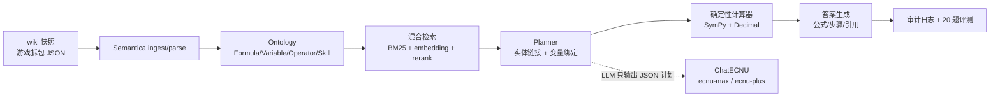

# 明日方舟数值问答与计算助手（akcalc）

> 数据挖掘课程期末大报告 · Semantica 课题五「专业领域问答与计算助手」
> 领域：明日方舟（CN 服）伤害 / 治疗 / 攻速数值计算

一个 **Ontology-grounded** 的中文 Data Agent：先把问题落到公式与干员实体上，再由**确定性计算器**结算，最后输出公式、代入步骤、结果与出处。模型只负责理解问题与组织语言，**不做算术**；知识库外的问题会拒答，缺变量会追问。

## 1. 它解决什么问题

明日方舟的伤害公式有几处反直觉的细节，通用大模型经常答错：

- 物理伤害的 **5% 保底按 `Atk_final` 计算**，不是按技能倍率后的伤害计算；
- 多段攻击的保底是**逐段结算**的；
- 法术抗性按比例减伤，物理防御按固定值减伤；
- 攻击间隔的直接修正与 ASPD 修正的结算顺序不同；
- 脆弱同类只取最高值、减伤按乘法叠加。

本项目把这些规则固化成 8 张 FormulaCard，实体库覆盖 421 名可获取干员（其中 667 个技能可自动计算），用 SymPy + Decimal 结算，并用 20 道题对比三种系统。

## 2. 核心特性

| 能力 | 实现 |
|---|---|
| 多源异构数据处理 | 游戏拆包 JSON（干员/技能/数值）+ wiki 机制页快照 |
| Ontology | `Formula / Variable / Operator / Skill / Calculation`，见 `data/kb/graph.json` |
| 检索 | jieba + BM25 + `ecnu-embedding-small` 向量召回 + `ecnu-rerank` 重排 |
| 规划 | 规则 planner（实体链接/变量抽取）+ LLM JSON 兜底；LLM 不做算术 |
| 计算 | SymPy 符号代入 + `Decimal` 求值 + 公式卡交叉校验 |
| 混合伤害 | 主伤害 + 天赋附加伤害分段结算；物理/法术分别套用 DEF/RES 与 5% 保底（如麒麟R夜刀二技能 16 段 150% 物理 + 75% 法术） |
| 动态面板 | 对特性攻击力随时间/击杀变化的技能输出参数化公式（如玛恩纳三技能，`k` 可代入蓄力时间与击杀数） |
| 治理 | 缺变量追问、超范围拒答、必须带出处、审计日志 |
| 评测 | 20 题 × 3 系统（full / rag / raw），数值/公式/引用/拒答/澄清/幻觉 6 项指标 |
| Semantica | `FileIngestor` + `DocumentParser`、`GraphBuilder`、`ProvenanceManager`（PROV 导出） |
| 演示 | Streamlit 六页签：问答、干员库、公式库、知识图谱、评测、审计 |

## 3. 架构



对应 Palantir 的思路：Ontology 是对象模型，Planner 是 AIP 侧的理解层，计算器是 Action，拒答/引用/审计是 Security & Governance，评测面板是 Evals & Observability。

## 4. 快速开始

环境：Windows / Python 3.11（Semantica 要求 `>=3.11,<3.14`；系统默认 3.14 不可用）。

```bash
cd /d/ECNU/data_digging/akcalc
uv venv --python 3.11 .venv
uv pip install --index-url https://mirrors.aliyun.com/pypi/simple -e ".[dev]"
uv pip install --index-url https://mirrors.aliyun.com/pypi/simple "semantica[parse-pdf,documents]"
```

配置模型（不要把 key 提交到仓库）：

```bash
cp .env.example .env
# 编辑 .env，填入 CHATECNU_API_KEY
```

构建数据与知识库：

```bash
.venv/Scripts/python.exe scripts/fetch_wiki.py           # wiki 机制页快照
.venv/Scripts/python.exe scripts/fetch_gamedata.py       # 固定 commit 下载官方拆包数据
.venv/Scripts/python.exe scripts/build_operators.py      # 生成全干员与 6 人基准 YAML
.venv/Scripts/python.exe scripts/build_kb.py             # SQLite + corpus + graph
.venv/Scripts/python.exe scripts/build_semantica_artifacts.py  # Semantica parse/graph/PROV
.venv/Scripts/python.exe scripts/smoke_api.py            # 验证 /models, chat, embedding, rerank
```

运行：

```bash
# CLI
.venv/Scripts/python.exe -m akcalc.cli ask "银灰三技能对防御500的敌人单次伤害是多少？"

# Web 演示
.venv/Scripts/streamlit.exe run src/akcalc/ui/streamlit_app.py

# 评测（三选一）
.venv/Scripts/python.exe scripts/run_eval.py --system full
.venv/Scripts/python.exe scripts/run_eval.py --system rag
.venv/Scripts/python.exe scripts/run_eval.py --system raw

# 汇总成报告表格
.venv/Scripts/python.exe scripts/make_report_assets.py
```

## 5. 评测结果（20 题，同一模型 ecnu-max）

| 系统 | 数值正确率 | 公式命中率 | 引用正确率 | 拒答正确率 | 澄清正确率 | 幻觉率 | 平均耗时 |
|---|---:|---:|---:|---:|---:|---:|---:|
| **full（本系统）** | **1.000** | **1.000** | **1.000** | **1.000** | **1.000** | **0.000** | **1.00 s** |
| rag（检索 + 大模型算） | 0.417 | N/A | N/A | 1.000 | 0.000 | 0.000 | 3.71 s |
| raw（纯大模型） | 0.333 | N/A | N/A | 0.667 | 1.000 | 0.333 | 14.6 s |

说明：

- 421 人语料下 naive RAG 只有 **41.7%**：top-k 常把“凛御银灰”排在“银灰”前，且只取到技能文档、漏掉干员面板；full 用确定性实体链接直接取面板，仍保持 100%。这说明全干员场景下“检索”本身不够，需要 Ontology/实体解析。
- 公式/引用两项只对 full 系统测量；rag/raw 没有结构化 plan 与引用字段。
- 20 题围绕 6 名基准干员设计；实体库已覆盖 421 名可获取干员、667 个可计算技能。这是**课程项目的受控评测**，不代表系统对全部明日方舟问题的泛化能力。
- 评测语料已移除公式卡中的示例答案，避免把 gold 数值泄漏进 RAG 上下文；早期版本曾出现该问题，已修复并重跑。
- 原始结果在 `results/eval_*.json`，汇总在 `results/report_tables.md`。

## 6. 目录

```
akcalc/
├─ data/
│  ├─ raw/gamedata/<commit>/     # 固定的官方拆包 JSON + meta.json(sha256)
│  ├─ raw/wiki/                  # wiki 机制页快照（HTML）
│  ├─ sources/sources.yaml       # 来源注册表与署名
│  ├─ curation/formulas.yaml     # 8 张公式卡（人工校订）
│  ├─ curation/operators.yaml    # 6 人基准（由脚本生成）
│  ├─ curation/operators_all.yaml # 421 名干员/967 个技能
│  └─ kb/                        # SQLite、corpus、graph、Semantica/PROV 产物
├─ src/akcalc/
│  ├─ schemas.py                 # Pydantic 对象模型
│  ├─ calculator.py              # 确定性计算 + 公式卡交叉校验
│  ├─ planner.py                 # 实体链接 + 变量抽取 + LLM 兜底
│  ├─ retrieval.py               # BM25 + embedding + rerank
│  ├─ agent.py                   # 编排、模板化答案、审计
│  ├─ eval.py                    # 指标与三系统 runner
│  ├─ semantica_adapter.py       # Semantica 适配层（可降级）
│  ├─ cli.py
│  └─ ui/streamlit_app.py
├─ eval/questions.jsonl          # 20 题 + gold + 引用期望
├─ scripts/                      # 数据、构建、评测、报告脚本
├─ tests/                        # 37 个单元测试
└─ results/                      # 评测 JSON/CSV/报告表格/日志
```

## 7. 数据来源与署名

- 机制公式：Arknights Terra Wiki（wiki.gg）的 `Damage/Physical`、`Damage/Arts`、`Damage/True`、`Attribute/Attack_interval`、`Damage_Reduction` 页面；快照在 `data/raw/wiki/`。
- 干员/技能数值：`Kengxxiao/ArknightsGameData`，固定 commit `63c7cec73c3858d0ae913f85cc89af3cef4d744f`（2026-11-01，CN 服）。
- Arknights 及相关素材版权归 Hypergryph / Studio Montagne 所有；本项目仅用于课程学习与研究，不整体再分发 wiki 内容。
- 每条公式与干员的出处记录在 `data/sources/sources.yaml`，并在 UI 与答案中展示。

## 8. 已知限制

- 实体覆盖 421 名干员，但公式计算只覆盖 667 个技能；召唤/浮游/陷阱/元素/持续伤害等复杂技能会拒答计算并说明原因。
- 基准仍为 6 名干员、8 张公式卡、M3/最高技能等级；不含潜能、信赖、模组、敌人数据库与元素伤害。
- `atk_final` 使用“ATK% 加算”的简化式；特殊天赋（如玛恩纳特性）用参数化公式处理，复杂跨天赋叠加仍需按 wiki 另行校订。
- `澄闪` 机制复杂，当前只做实体展示，计算题会拒答；`玛恩纳` 已支持参数化公式，特性倍率 `k` 可代入蓄力时间与击杀数。
- Semantica 用于 ingest/parse、图谱构建与 provenance；运行时检索使用自建混合检索，未直接使用 Semantica 的 VectorStore（受课程环境与依赖体积限制）。
- 评测规模 20 题，适合课程对比，不足以支撑统计显著性结论。
